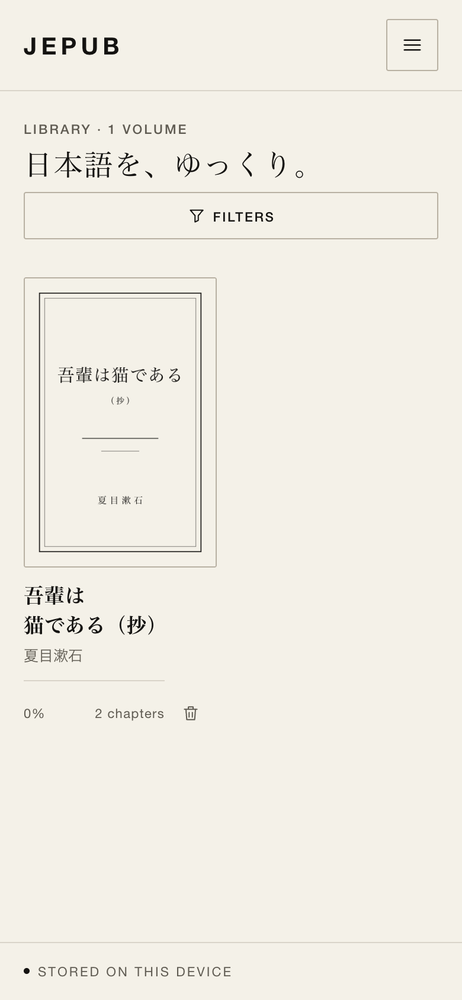
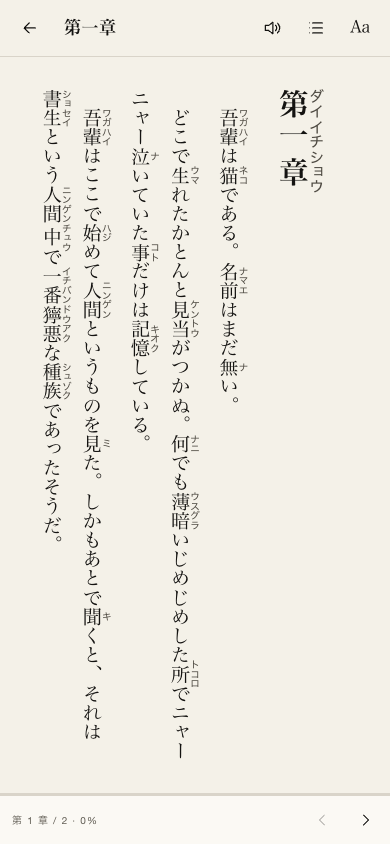
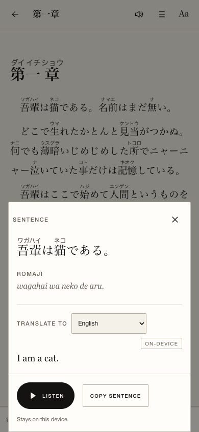
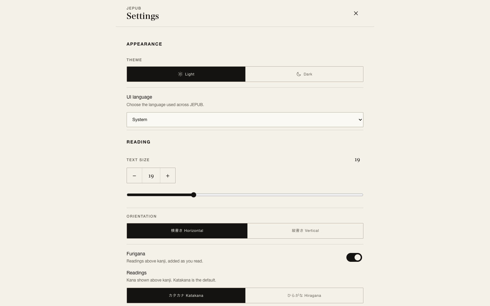

# JEPUB

### A quiet Japanese EPUB reader for the web.

[**Open JEPUB →**](https://caroluschan.github.io/jepub/) · [Features](#features) · [Add books](#add-books) · [Install](#install-as-an-app) · [Run locally](#run-locally)

JEPUB is a small, monochrome reading room for Japanese books. It keeps your library on your device, puts readings above kanji, and lets you tap any sentence to see how it sounds, what it means, and hear it spoken aloud.

<p align="center">
  
  
  
</p>

<p align="center">
  
</p>

<p align="center"><sub>Screenshots use the bundled public-domain sample book.</sub></p>

## Features

**A shelf that stays yours**
- Import EPUB and MOBI files from your device, or drag and drop them onto the shelf. Open EPUB files from another app on supported browsers.
- Add plain `.txt` files in UTF-8, UTF-16, or Shift_JIS.
- Download public-domain works directly from Aozora Bunko.
- Books, covers, chapters, reading positions, and translated sentences are stored locally in IndexedDB.
- JEPUB asks the browser for persistent storage, so your shelf survives ordinary browser restarts.

**A reader made for Japanese**
- Kuroshiro furigana above kanji. Katakana readings by default, with a Hiragana option.
- Vertical Japanese (`vertical-rl`) or horizontal layout.
- Adjustable text size from 14–32px.
- Light and dark monochrome themes.
- Table of contents, chapter navigation, illustrations, bookmarks, and restored reading positions.
- A full Settings page, opened from the library or the reader, with appearance, reading, translation, storage, and about sections.
- Eight interface languages: English, Japanese, Simplified Chinese, Traditional Chinese, Korean, Spanish, French, and German. System language is used by default.
- Share the stored EPUB/MOBI/TXT file, or the Aozora Bunko card link, with the native share sheet.
- Lazy furigana: readings are prepared as you reach each part of the book, not all at once.

**Bookmarks and sharing**
- Add or remove a bookmark from the reading footer; bookmarks store the chapter and exact scroll position.
- Open the Contents drawer and switch to **Bookmarks** to jump to or delete saved places. Bookmarks persist across reloads.
- Share the original EPUB/MOBI/TXT file through the browser's share sheet, with a download fallback where file sharing is unavailable.
- Aozora Bunko imports share their source card link instead of a downloaded file.

**Tap a sentence**
- Ruby readings, spaced romaji, and a translation panel.
- Choose from 39 target languages supported by Chrome’s on-device translator.
- On-device translation is used first when available.
- MyMemory is available as an explicit opt-in fallback when on-device translation is not available.
- Translations are cached per language, so a translated sentence can be revisited instantly, even offline.
- Play or stop the sentence with a Japanese (`ja-JP`) voice.

**AI, three ways**
- Choose **Off**, **BYOT** (bring your own token), or **Local** in Settings.
- **BYOT** calls the provider you choose directly: OpenAI, Anthropic, Google Gemini, OpenRouter, Groq, Mistral, DeepSeek, xAI, Together AI, Cerebras, Perplexity, Fireworks AI, Qwen/DashScope, or a custom OpenAI-compatible endpoint.
- BYOT keeps the API key in this browser, fetches the provider's current model list when possible, and always allows a manually typed model ID when the catalog changes.
- **Ask AI** and **Chat More** work the same in every mode; answers render sanitized Markdown and chat sessions stay in IndexedDB on this device.
- BYOT needs a connection. The sentence-sheet AI button and chat composer are disabled while offline.

**Local AI, only where it fits**
- Uses a 4-bit Qwen3.5-0.8B model (about 645 MB). The model downloads once, only after an explicit warning and consent.
- Requires WebGPU, iOS/iPadOS 26+, Android 12+, sufficient GPU storage-buffer limits, and free storage. On devices that do not meet the gate, the Local option is not offered.
- This is a small local model: it can be slow and make mistakes. It is not a replacement for a teacher.

**Listen**
- Read a sentence aloud from the sentence panel.
- Start chapter read-aloud from the toolbar; JEPUB highlights the active sentence and scrolls with the voice.
- Uses the voices installed on your device.

**A proper little PWA**
- Installable on desktop and mobile.
- Offline app shell after install.
- The Japanese dictionary needed for furigana is cached for offline reading.
- EPUB file handling where the browser supports it, with a normal file picker everywhere else.
- A quiet update prompt when a new version is ready.

## Add books

| Source | How it works |
|---|---|
| **EPUB / MOBI** | Choose one or more `.epub` or `.mobi` files, or drop them onto the shelf. |
| **Text** | Choose `.txt` files. The filename becomes the title; paragraphs become the chapter. |
| **Aozora Bunko** | Open a work on [aozora.gr.jp](https://www.aozora.gr.jp/), copy its card URL (or a direct `.html` file URL), and paste it into the Aozora tab. |

Aozora downloads are fetched through [Jina Reader](https://jina.ai/reader/) because browsers cannot call Aozora directly. This means the Aozora import needs an internet connection.

## Install as an app

- **iPhone / iPad:** open the site in Safari → Share → **Add to Home Screen**.
- **Android / Chrome:** open the browser menu → **Install app** or **Add to Home screen**.
- **Desktop Chrome / Edge:** use the install icon in the address bar.

Once installed, the app opens without browser chrome and the dictionary is prepared for offline furigana.

## iPhone and offline translation

Safari on iPhone does not expose an on-device translation API to websites or home-screen PWAs. The 39-language selector still works there, but translations use **MyMemory online** when you enable the online fallback.

BYOT works on any iPhone with an internet connection and a provider API key. Local AI is a separate, optional path: on iOS/iPadOS 26+ devices with WebGPU, enough GPU memory, and free storage, JEPUB can download and run the small Qwen model entirely on-device. Older devices, including the base iPhone 15, do not get the Local option, but can still use BYOT.

## Browser support

| Browser | Library & reader | On-device translation | BYOT | Local AI | Online fallback |
|---|---|---|---|---|---|
| Chrome / Edge desktop | Yes | Yes, 39 language packs | Yes | WebGPU, 645 MB opt-in | Optional |
| Chrome Android | Yes | Not available from the web API | Yes | Android 12+, WebGPU, buffer/storage gate | Optional |
| Safari / iOS Safari | Yes | Not available from the web API | Yes | iOS/iPadOS 26+, WebGPU, buffer/storage gate | Optional |
| Firefox | Yes | Not available from the web API | Yes | Not currently | Optional |

The app itself works across modern browsers. Translation providers and installed speech voices vary by device.

## Privacy

- **No account, no analytics, no JEPUB server.** Your books stay in your browser’s storage.
- **Online translation is opt-in.** When enabled, the selected sentence is sent to MyMemory and the provider is labeled in the sentence panel. With online translation off, only on-device translation and cached results are used.
- **Local AI is opt-in.** After consent, the model downloads from Hugging Face and runs on this device. Sentences and chat messages are not sent to a JEPUB server. Chat sessions stay in IndexedDB. You can revoke consent or remove the model in Settings.
- **BYOT is your provider relationship.** Your API key is stored in this browser and sent directly to the provider you select. JEPUB does not proxy or store the key on a server. Use a restricted key and review your provider's data policy.
- **Aozora imports** send the public Aozora URL through Jina Reader. Aozora works are public-domain texts.
- **Speech** uses the operating system’s speech voices. Depending on the installed voice, the OS may use a local or cloud-backed voice.
- **GitHub Pages** serves the app from a shared `github.io` origin. As with any project page, other pages on the same origin share browser storage permissions. Use a dedicated origin if you need stronger isolation.

## Run locally

Requirements: **Node 22.22.2+** and npm. The repository includes `.nvmrc` (`22.23.3`).

```bash
git clone https://github.com/caroluschan/jepub.git
cd jepub
nvm use
npm install
npm run dev
```

The dev server runs at `http://localhost:5173/jepub/`.

`npm run dev` and `npm run build` run `prepare:assets` automatically. It:

- copies the 12 kuromoji dictionary files into `public/kuromoji-dict/`
- generates the PWA icons
- builds the bundled public-domain sample EPUB

## Scripts

```bash
npm run dev          # development server
npm run typecheck    # TypeScript
npm test             # Vitest unit tests
npm run build        # typecheck + production build into docs/
npm run preview      # preview the production build
npx playwright test  # end-to-end tests (uses installed Chrome)
npm run prepare:assets
```

## Deploying

The production build is written to `docs/` and can be served directly by GitHub Pages.

```bash
npm run build
git add docs
git commit -m "chore: publish pages build"
git push origin main
```

In the repository settings, set **Pages → Build and deployment → Source** to **Deploy from a branch**, branch `main`, folder `/docs`.

The app is built for the project path `/jepub/`. If you fork it under a different repository name, update `base` in `vite.config.ts`, the manifest `start_url`/`scope`, and the route links accordingly.

## Tech

- React 19 + Vite 7 + TypeScript
- `vite-plugin-pwa` / Workbox for offline support
- IndexedDB via `idb`
- EPUB parsing with JSZip
- MOBI/KF8 parsing with `@lingo-reader/mobi-parser`
- Kuroshiro + kuromoji for furigana and romaji, with a custom browser dictionary loader
- DOMPurify for sanitized ruby markup
- Chrome built-in Translator API and MyMemory for translation
- Transformers.js and ONNX Runtime WebGPU for optional local AI
- Direct BYOT streaming to OpenAI-compatible, Anthropic, and Gemini APIs
- Web Speech API for Japanese speech
- Vitest and Playwright for tests

## Project map

```
src/lib/epub/        EPUB container, OPF, TOC, content extraction
src/lib/import/      EPUB, MOBI, text, Aozora, and persistence pipelines
src/lib/furigana/    Kuroshiro, dictionary loader, queue, sanitizer
src/lib/translate/   language list, providers, cache
src/lib/llm/        capability gate, model worker, prompts
src/lib/chat/       local chat session helpers
src/lib/reader/     scroll behavior
src/features/       library, reader, sentence panel, settings, AI, chat
src/pwa/             service worker update and file handling
scripts/             dictionary, icons, and sample EPUB generation
tests/               unit and end-to-end tests
docs/                committed production build
```

## Credits

- Sample text: Natsume Sōseki, *Wagahai wa Neko de Aru* (public domain); sample cover and illustration generated for this project.
- [Kuroshiro](https://github.com/hexenq/kuroshiro) and [kuromoji](https://github.com/takuyaa/kuromoji.js)
- [@lingo-reader/mobi-parser](https://github.com/hhk-png/lingo-reader) for MOBI/KF8 parsing
- [JSZip](https://stuk.github.io/jszip/), [idb](https://github.com/jakearchibald/idb), [DOMPurify](https://github.com/cure53/DOMPurify)
- [Vite](https://vite.dev/), [React](https://react.dev/), [Vitest](https://vitest.dev/), [Playwright](https://playwright.dev/)
- [Aozora Bunko](https://www.aozora.gr.jp/) for public-domain Japanese literature
- [Jina Reader](https://jina.ai/reader/) for Aozora fetching
- [MyMemory](https://mymemory.translated.net/) for optional online translation
- [Qwen3.5-0.8B](https://huggingface.co/Qwen/Qwen3.5-0.8B) and [Transformers.js](https://huggingface.co/docs/transformers.js) for optional local AI

Third-party dependencies retain their own licenses.

---

<p align="center"><em>日本語を、ゆっくり。</em></p>
